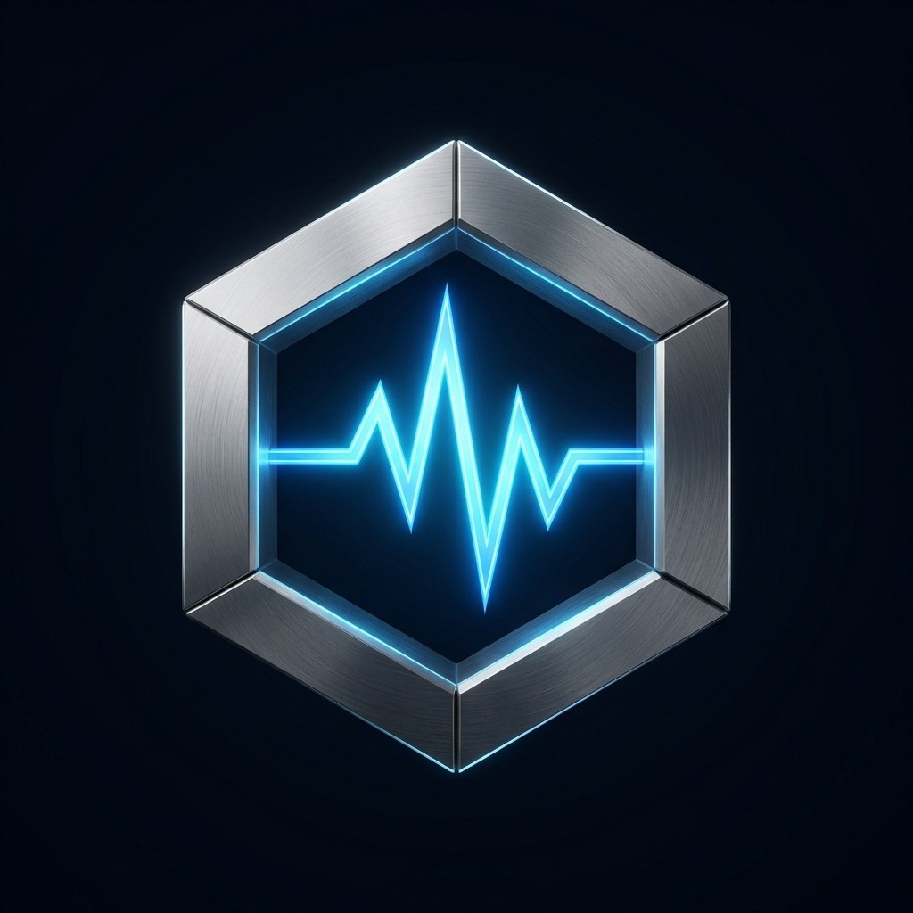

# ⚡ NexPulse Portal
### Sistema Industrial de Monitoramento, Rastreabilidade e Copiloto IA para Células de Paletização

*Painel web interativo de alta fidelidade para chão de fábrica, integrando Gêmeo Digital 3D (Three.js), cálculo de OEE em tempo real, motor de simulação IIoT e Agente de Inteligência Industrial com isolamento Read-Only OT.*

---

## 🚀 Sobre o Projeto

O **NexPulse Portal** é uma solução de Supervisório HMI e IIoT desenvolvida para o monitoramento avançado de processos de paletização industrial. Projetado sob os princípios de ergonomia de chão de fábrica (ISA-101) e design minimalista de alta fidelidade, o sistema combina simulação determinística em tempo real com capacidades analíticas alimentadas pelo **Google Gemini (@google/genai)**.

---

## 🛠️ Stack Tecnológica & Arquitetura

| Camada | Tecnologias Utilizadas |
| :--- | :--- |
| **Frontend** | React 19, TypeScript, Tailwind CSS v4, Three.js (WebGL 3D), Lucide React, Motion |
| **Backend & Tempo Real** | Node.js, Express, WebSocket (`/ws`) para sincronização instantânea de estado |
| **Motor Industrial** | Lógica determinística de ciclos, cálculo de OEE (Disponibilidade, Desempenho, Qualidade), EWMA de tempo de ciclo e Pareto de paradas |
| **Inteligência Artificial** | `@google/genai` (SDK oficial), Tool Calling assíncrono com ferramentas Read-Only e Structured Outputs |
| **Qualidade & Testes** | Node Test Runner (`node:test`), TypeScript (`tsc --noEmit`), Playwright E2E |

---

## ✨ Principais Funcionalidades

1. **Gêmeo Digital 3D & Mosaico 2D**:
   - Renderização 3D procedural da célula robótica de 6 eixos, esteiras de entrada/saída e formação de paletes com caixas PBR.
   - Modos de câmera instantâneos (*Geral, Topo, Garra, Esteira*) e filtro interativo por camadas (`C1` a `CN`).
   - Inspetor de caixas em tempo real (exibe código `CX-XXXXX`, posição XYZ, peso em kg e dimensões).

2. **Indicadores de Produção & OEE**:
   - Cálculo automático de OEE global, taxa de cadência em caixas por minuto, progresso do palete atual e aderência à meta do turno.
   - Gráficos de throughput histórico com amostragem responsiva e análise de Pareto de paradas.

3. **Agente Industrial NexPulse (IA)**:
   - **Isolamento de Segurança OT (Read-Only)**: As ferramentas do agente possuem acesso estrito de leitura ao cache e aos buffers de telemetria, impedindo qualquer comando de escrita direta ou bypass de segurança no CLP.
   - **Diagnóstico Guiado de Alarmes**: Varredura automática do contexto imediatamente anterior à falha (código do alarme e sensores ópticos) para sugerir verificação física segura.
   - **Classificação Rápida em 1 Clique**: Sugestão automática de códigos de motivo (`ReasonCodes`) para eventos de paradas não justificadas.
   - **Auditoria Preditiva (EWMA)**: Detecção de desvios graduais no tempo de ciclo e picos de microparadas antes de quebras críticas.

4. **Gateway IIoT & CLP v1**:
   - Ingestão opcional via REST (`POST /api/v1/telemetry`) com verificação de token para integração com Node-RED, MQTT ou PLCs externos.

---

## ⚙️ Instalação e Execução Local

### Pré-requisitos
- Node.js `v20.0.0+` instalado.
- Chave da API Gemini (`GEMINI_API_KEY`) configurada no arquivo `.env`.

### 1. Clonar o repositório e instalar dependências
\`\``bash
git clone https://github.com/seu-usuario/nexpulse-portal.git
cd nexpulse-portal
npm install
\`\``

### 2. Configurar variáveis de ambiente
Copie o arquivo de exemplo e insira sua chave da API Gemini:
\`\``bash
cp .env.example .env
\`\``
*(Edite o arquivo `.env` e defina sua `GEMINI_API_KEY`).*

### 3. Iniciar o servidor de desenvolvimento
\`\``bash
npm run dev
\`\``
O aplicativo estará disponível em **`http://localhost:3000`** (com o backend Express e o WebSockets escutando na mesma porta).

---

## 🧪 Testes Automatizados

Para executar os testes unitários rápidos do motor de paletização, regras de OEE e ferramentas Read-Only do agente:
\`\``bash
npx tsx --test src/simulation/palletEngine.test.ts src/agent/agent.test.ts
\`\``

---

## 📂 Estrutura do Projeto

\`\``text
├── server.ts                  # Servidor Express + WebSocket + Endpoints REST
├── src/
│   ├── App.tsx                # Componente principal do HMI
│   ├── index.css              # Estilos globais Tailwind v4 e animações cinéticas
│   ├── agent/                 # Agente de Inteligência Industrial (Prompt, Tools, Service)
│   ├── components/            # Componentes de UI (Sidebar, TopBar, KpiStrip, Pallet3D, Alerts)
│   ├── server/                # Validação de payloads e persistência
│   └── simulation/            # Motor determinístico de paletização e testes unitários
├── public/                    # Assets estáticos e imagens de alta fidelidade
└── package.json               # Dependências e scripts
\`\``

---

## 📄 Licença

Este projeto é distribuído sob a licença **Apache 2.0**. Veja o arquivo `LICENSE` para mais detalhes.

---

  Desenvolvido com excelência em engenharia de automação e inteligência artificial.

